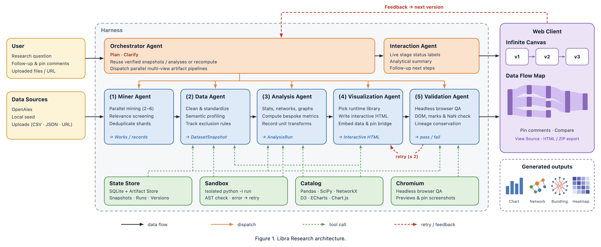

# Libra Research

Multi-agent LLM framework and interactive web application for end-to-end data analysis and visualization.

> The standalone backend for scientific paper reproduction is in [Libra-Reproduce-Backend](https://github.com/orwhd/Libra-Reproduce-Backend). This web app also includes a mode toggle in the home title to preview `Reproduce` mode.

## Design



- Vector formats: [PDF](design/project1_system_architecture.pdf) · [SVG](design/project1_system_architecture.svg)

## Implementation Overview

### Dataset
- Uses [OpenAlex](https://openalex.org/) for scholarly data queries, with a documented local OpenAlex subset in [`data/seed/`](data/seed/README_DATA.md) for offline reproducibility.
- Also supports user-uploaded datasets (CSV, TSV, JSON, JSONL, or URL).

### Multi-Agent Workflow & Harness (T1)
- **Agent collaboration**: An orchestrator plans each request and coordinates specialized agents across data retrieval (Miner), cleaning and profiling (Data), statistical and graph computation (Analysis), chart generation (Visualization), browser-based verification (Validation), and response summarization (Interaction).
- **Execution environment & retries**: Generated Python preprocessing and analysis scripts execute in isolated subprocesses with static safety checks and resource limits. When execution or rendering fails, diagnostics are routed back to the responsible agent in a bounded retry loop.
- **Intermediate artifacts**: Datasets, analysis outputs, and visualization versions are stored locally so follow-up edits can reuse prior results when recomputation is not needed.

### Interactive Web Interface (T2)
- Users submit natural-language analytical questions, attach uploaded files or existing artifacts, inspect interactive visualizations on a canvas, and request follow-up analyses or visual modifications.
- Supports version history, side-by-side comparison, data lineage inspection, anchored feedback comments on visualizations, source viewing, and export.

### Visualization Capabilities & Generalizability (T3)
- **Representation and rendering**: Instead of hardcoding chart templates or visualization-specific workflows, the system discovers available Python analysis libraries (Pandas, NumPy, SciPy, NetworkX) and frontend visualization libraries (D3.js, ECharts, Chart.js), computes the required data, generates self-contained interactive HTML/JS visualizations, and verifies the rendered output in headless Chromium before delivery.
- **Demonstrated outputs**:
  - **Standard statistical charts**: Interactive bar, line, histogram, and scatter charts with tooltips and filtering.
  - **Network visualizations**: Algorithmic node-link graphs (e.g., force-directed layouts) for citation and collaboration networks.
  - **Advanced network layouts**: Hierarchical edge bundling with interactive layout controls.
  - **Generalizability**: Other visualization types (such as heatmaps and Sankey diagrams) are handled through the same library-selection and code-generation pipeline.

## Setup & Usage

### Prerequisites
- Python 3.13+ with [`uv`](https://docs.astral.sh/uv/)
- Node.js 20+ with [`pnpm`](https://pnpm.io/)

### Install Dependencies

```bash
git clone https://github.com/orwhd/Libra-Research.git
cd Libra-Research

cd backend && uv sync
cd ../frontend && pnpm install
cd ..
```

### Configure API Credentials
- **In-app settings**: Start the app and open the API configuration dialog from the home screen to enter your OpenAI-compatible API key, base URL, and model.
- **Environment file**: Or copy `.env.example` to `.env` and set `LLM_API_KEY`, `LLM_BASE_URL`, and `LLM_MODEL` (optional: `OPENALEX_API_KEY`).

### Run the Application

```bash
./start.sh
# Backend:  http://127.0.0.1:8000
# Frontend: http://127.0.0.1:5173
```

## Status & Technical Decisions

### What Works
- End-to-end multi-agent data science workflow covering data retrieval, preprocessing, sandboxed computation, visualization generation, automated rendering checks, and iterative refinement.
- Interactive web interface with natural-language chat, canvas versioning, side-by-side comparison, data lineage inspection, and anchored comments.
- Generalizable interactive visualizations across standard statistical charts, force-directed networks, hierarchical edge bundling, and other chart types without hardcoded workflows.

### What Is Incomplete
- Script isolation targets local single-user execution rather than multi-tenant cloud sandboxing (e.g., containers or microVMs).
- Workspaces and artifacts are stored locally in SQLite and on disk without multi-user authentication or remote storage.
- Comment snapshots preserve DOM control states and scroll position, but do not capture arbitrary internal canvas/WebGL transform state unless exposed via DOM controls.

### Main Technical Decisions
- **Library discovery and code generation over fixed templates**: Agents select suitable analysis and visualization libraries and generate runnable code rather than dispatching to predefined chart templates, keeping the framework extensible to new visualization techniques.
- **Sandboxed computation with browser validation**: Executing generated Python in isolated subprocesses and verifying rendered HTML in headless Chromium catches computation and rendering failures before results reach the user.
- **Persisted intermediate artifacts**: Storing datasets, analysis outputs, and visualization versions separately allows follow-up modifications to iterate cleanly without unnecessary recomputation.
