# Libra Research — LLM Multi-Agent Framework for Interactive Visual Data Science

**WHALES Lab Coding / Design Test — Project 1 Deliverable**

Libra Research is an end-to-end, **harness-engineered multi-agent framework** for exploratory data science and interactive visualization built on **OpenAlex** scholarly literature (plus arbitrary user-uploaded CSV/TSV/JSON/JSONL/URL datasets). Users pose natural-language research questions, watch live data-processing reports above a streaming stage indicator, explore interactive visualizations on an **Infinite Research Canvas**, pin **scroll-locked visual comments** onto specific chart marks or provenance nodes, evolve new versions rightward (`v1 -> v2 -> v3`) via Chat, audit record-level transformations in a **5-stage Semantic Data Flow Map**, and compare any two versions side-by-side.

---

## Table of Contents

1. [System Architecture & Agent Collaboration (T1)](#1-system-architecture--agent-collaboration-t1)
2. [How Computation & Visualizations Work (T2, T3 & Generalizability)](#2-how-computation--visualizations-work-t2-t3--generalizability)
3. [What Works, Scope Boundaries & Main Technical Decisions](#3-what-works-scope-boundaries--main-technical-decisions)
4. [Quick Start & Setup Instructions](#4-quick-start--setup-instructions)
5. [Reproducing T3 Visualizations & Iterative Workflows](#5-reproducing-t3-visualizations--iterative-workflows)
6. [Automated Verification Suite](#6-automated-verification-suite)

---

## 1. System Architecture & Agent Collaboration (T1)

Paper-style architecture figure (Part II Design Test — Option A):
- [design/project1_system_architecture.pdf](design/project1_system_architecture.pdf) ([PNG preview](design/project1_system_architecture.png))
- Detailed design docs: [docs/implementation_plan.md](docs/implementation_plan.md) · [docs/architecture_draft.md](docs/architecture_draft.md) · [docs/limitations.md](docs/limitations.md)

```mermaid
flowchart LR
  U["User Query / Attached Files / Pinned Comments"] --> O["Orchestrator Agent"]
  O -->|"Adaptive 2–6 Shards"| M["MinerCoordinator & Parallel MinerWorkers"]
  M --> D["DataAgent + SemanticProfiler (python -I Sandbox)"]
  D -->|"Immutable DatasetSnapshot"| A["AnalysisAgent (python -I Sandbox)"]
  A -->|"Computed Metrics & Graph JSON"| V["VisualizationAgent (ECharts 5 / D3 v7 / Chart.js 4)"]
  V --> Q["ValidationAgent (Headless Chromium QA + Conservation Check)"]
  Q -->|"Pass"| C["Infinite Canvas + Semantic Data Map v2"]
  Q -->|"Fail (<= 2 Retries)"| V
  C -->|"Deferred Pin Comments + Chat"| O
```



### Multi-Agent Roles
1. **`Orchestrator` (`backend/app/agents/orchestrator.py`)**: Interprets user intent, workspace history, attached canvas cards, and pending `VisualComment`s; asks for clarification when revision targets are ambiguous; decides whether a revision can **reuse** an immutable `DatasetSnapshot` and/or `AnalysisRun` (fast visual iteration) or requires fresh mining/recomputation; streams encapsulated data-focused progress notes over SSE.
2. **`MinerCoordinator` & `MinerWorker`s (`backend/app/agents/miner_agent.py`)**: Dynamically translates research prompts into complementary academic search facets, estimates required sample volume (`160–600`), activates **2 to 6 parallel Miner Agents** against the live OpenAlex Works API (with automatic offline fallback to the verified local OpenAlex seed corpus), scores topical relevance, strips off-topic/incomplete noise, and deduplicates across shards while preserving per-shard provenance.
3. **`DataAgent` + `SemanticProfiler` (`backend/app/agents/data_agent.py`, `backend/app/services/semantic_profiler.py`)**: Generates and executes Python 3.13 cleaning scripts inside an isolated `python -I` sandbox to produce immutable `DatasetSnapshot`s, then classifies records into mutually exclusive semantic categories while deterministically reconciling retained vs. excluded counts in Python (never letting the LLM guess counts).
4. **`AnalysisAgent` (`backend/app/agents/analysis_agent.py`)**: Introspects snapshot schemas and installed sandbox packages (`pandas`, `numpy`, `scipy`, `networkx`, `scikit-learn`) at runtime to compute statistical series, co-authorship/citation networks, community clusters, hierarchical taxonomies, or contingency matrices, recording explicit unit-conversion metadata (`unit_transform`).
5. **`VisualizationAgent` (`backend/app/agents/visualization_agent.py`)**: Inspects the exact computed JSON schema, discovers locally hosted visualization libraries dynamically from `backend/app/static/vendor/`, incorporates multimodal comment screenshots + DOM target inspector metadata on revisions, and generates responsive Chart-First interactive HTML5 artifacts.
6. **`ValidationAgent` (`backend/app/agents/validation_agent.py`, `backend/app/services/browser_validator.py`)**: Loads generated HTML via local `file://` URIs in a reusable headless Chromium instance to verify zero uncaught JS/console errors, valid `<svg>` / `<canvas>` dimensions (`>= 200x150`), absence of `NaN`/`undefined` geometry attributes, hover interactivity, and exact lineage record conservation before publishing to the Canvas.
7. **`InteractionAgent` (`backend/app/agents/interaction_agent.py`)**: Synthesizes domain-specific streaming status labels, concise empirical summaries, and 3 actionable next-step exploration options.

---

## 2. How Computation & Visualizations Work (T2, T3 & Generalizability)

### Generalizability (Zero Hardcoding)
- **No prompt templates or chart-type `if/elif` routers**: `capability_catalog.py` introspects installed Python scientific libraries (`importlib.metadata`) and scans `backend/app/static/vendor/*.js` at runtime (`D3.js v7`, `Apache ECharts 5`, `Chart.js 4`, plus native SVG/Canvas/WebGL). Agents autonomously select algorithms and rendering libraries suited to any analytical request — supporting standard statistical charts, force-directed collaboration networks, hierarchical edge bundling, heatmaps, Sankey diagrams, radar/parallel coordinates, and custom composite views alike.

### Sandboxed Code Execution
- All LLM-generated data-cleaning and analytical Python scripts execute inside `sandbox_runner.py` (`python -I` isolated mode, AST-level blocklist against network/process/filesystem-escape imports, stripped environment variables with **zero API keys**, 25-second timeout, and POSIX `RLIMIT_CPU` / `RLIMIT_FSIZE` caps).

### Interactive Web Canvas & Provenance
- **Infinite Canvas (`InfiniteCanvas.tsx`)**: New sibling outputs stack vertically (`v1`); iterative revisions branch horizontally to the right (`v1 -> v2 -> v3`) connected by directed Bézier edges. Supports pan, `Cmd/Ctrl + Wheel` or horizontal `%`-pill scrub zoom, right-drag box-selection, and right-click context menu (`Attach to Chat`, `Compare`, `Delete`, `Fit to View`).
- **80% Modal & Floating Dock (`ArtifactWindow.tsx`)**: Switch seamlessly between `Preview`, `Data Map`, `Comment`, `View Source`, `Download` (standalone offline single-file HTML with vendor JS inlined, or full provenance `.zip` bundle with Python scripts + JSON data + lineage), and `Delete`.
- **Semantic Data Flow Map (`DataMapView.tsx`)**: Interactive 5-column Sankey provenance graph (`Data Sources -> Semantic Categories -> Processing Outcomes -> Processed Dataset -> Analysis`) answering where data came from, which semantic types were retained or excluded (and why), and how record units transformed (with one-click toggle to Legacy 6-Stage Lineage).
- **Scroll-Locked Pinpoint Comments (`CommentsOverlay.tsx`)**: Clicking any visual mark or Data Map node saves a `pending` pin instantaneously (`<15ms`), locks the pin to the underlying iframe scroll offset (`RC_SCROLL_STATE`), pierces overlay layers via `document.elementsFromPoint` to capture DOM paths and nearby axis/value labels, and renders a background annotated screenshot with hover tooltips revealed — without triggering an Agent until the user submits a Chat turn.

---

## 3. What Works, Scope Boundaries & Main Technical Decisions

### What Works End-to-End
- Natural-language multi-agent workflow from live parallel OpenAlex mining (or local CSV/TSV/JSON/URL upload) through sandboxed Python analysis, multi-library interactive HTML generation, headless Chromium QA with automatic self-healing retries (`<= 2`), and persistent SQLite workspace recovery.
- All three **T3** demonstration paradigms (interactive statistical charts, force-directed collaboration/citation networks, hierarchical edge bundling) **plus** unseen chart types (e.g., TF-IDF/NMF topic-by-year heatmaps, Sankey flows, distributions).
- In-app **API Configuration UI** on the landing page (supports any OpenAI-compatible `sk-` endpoint, live `/models` list fetching, model switcher, and `Low / Medium / High` thinking effort selector, with Smart Animation state transition).
- Side-by-side **Dual-Pane Compare** with independent Docks (`Preview` / `Data Map` / `Comment` / `Source`) on both panes.

### Main Technical Decisions
1. **Code Generation over Static JSON Chart Specs**: Having `AnalysisAgent` emit executable Python and `VisualizationAgent` emit complete HTML5 + JS (`D3 v7` / `ECharts 5` / `Chart.js 4`) allows arbitrary algorithmic layouts (such as radial `d3.cluster` + `d3.lineRadial().curve(d3.curveBundle.beta(...))` with live tension sliders) that rigid chart-config schemas cannot express.
2. **Adaptive Parallel Mining + Verified Local Seed Fallback**: Live OpenAlex queries scale across 2–6 concurrent shard miners for topical breadth and sample volume, while [data/seed/openalex_ai_works_2018_2025.json](data/seed/openalex_ai_works_2018_2025.json) guarantees deterministic offline execution if public API rate limits occur.
3. **Deterministic Lineage Counting**: LLMs propose semantic classification rules, while Python evaluates every rule and exclusion count over actual records so Data Map numbers are 100% conserved and auditable.
4. **Reusable `file://` Headless Chromium Validator**: Keeping a warm per-loop Chromium instance and loading local `file://` HTML + vendor URIs avoids cold browser startup overhead and eliminates `document.write` escaping bugs.

### Current Limitations / Incomplete Items (Documented Honestly)
- **Single-User Local Persistence**: State is stored locally in SQLite + `data/runtime/` (gitignored) without multi-user cloud auth.
- **Subprocess Sandbox Scope**: `python -I` + AST validation + resource limits protect local research workflows; multi-tenant production deployment would wrap execution in container/microVM isolation.
- **Demo Video**: Per submission instructions, the `< 5 min` narrated demo video is recorded externally against the running local app (`./start.sh`) and submitted alongside the repository link. (Project 2 is not attempted; this repository delivers Project 1 + Part II Design Test Option A.)

---

## 4. Quick Start & Setup Instructions

### Prerequisites
- **Python 3.13+** with [`uv`](https://docs.astral.sh/uv/)
- **Node.js 20+** with [`pnpm`](https://pnpm.io/)
- Google Chrome (or Playwright Chromium: `cd backend && uv run playwright install chromium`)

### 1. Install Dependencies

```bash
# Backend dependencies (FastAPI, OpenAI SDK, Pandas, SciPy, NetworkX, Scikit-Learn, Playwright)
cd backend && uv sync --python 3.13
cd ..

# Frontend dependencies (React 19, TypeScript, Vite, Lucide)
cd frontend && pnpm install
cd ..
```

### 2. Configure LLM API Key (Two Safe Options — Zero Hardcoded Keys)

- **Option A — In-App UI (Recommended)**: Start the app, click **`click me to complete API config!`** below the `Libra Research` badge on the home screen, enter your API Base URL & `sk-...` key, click **Fetch Models** to pull available models, test connection, and save (stored locally in gitignored `data/runtime/user_api_config.json`).
- **Option B — `.env` File**:
  ```bash
  cp .env.example .env
  # Edit .env and set LLM_API_KEY, LLM_BASE_URL, and LLM_MODEL
  ```

### 3. Start Both Servers

```bash
./start.sh
```

Or run in two terminals:

```bash
# Terminal 1 — Backend API (http://127.0.0.1:8000)
cd backend && uv run uvicorn app.main:app --host 127.0.0.1 --port 8000

# Terminal 2 — Frontend Web App (http://127.0.0.1:5173)
cd frontend && pnpm dev --host 127.0.0.1 --port 5173
```

Open **`http://127.0.0.1:5173`** in your browser.

---

## 5. Reproducing T3 Visualizations & Iterative Workflows

1. **All Three T3 Outputs in One Multi-Artifact Prompt** (Statistical Trend + Force-Directed Network + Hierarchical Edge Bundling):
   > *"Analyze recent Human-Computer Interaction (or AI) research: build (1) an interactive publication & citation trend chart, (2) a force-directed author collaboration network with community detection, and (3) a hierarchical edge bundling view of research topics."*
2. **Generalizability Beyond the Three Examples**:
   > *"Create an interactive topic-by-year heatmap and citation distribution breakdown with dynamic sorting, filtering, and hover explanations."*
3. **Pinpoint Visual Commenting & Rightward Version Evolution**:
   - Click any Canvas card to open the 80% modal -> click the **Comment** icon in the bottom Dock -> click any bar, node, or Data Map category -> type feedback and click **Save** (instantaneous; does not trigger an agent).
   - Send a follow-up instruction in Chat (or simply click Send with the comment attached) -> a revised `v2` card is validated and placed immediately to the **right** of `v1`.
4. **Side-by-Side Compare**:
   - Right-drag across two cards on the Canvas to box-select them -> right-click -> **Compare**.

---

## 6. Automated Verification Suite

All tests run against an isolated temporary SQLite/runtime directory (`backend/tests/conftest.py`) and never touch local user data:

```bash
# Fast unit, sandbox security, Semantic Data Map v2 conservation & API persistence tests (18 tests)
cd backend && uv run pytest -k "not s10_s11" -v

# Full suite including live LLM + fault-injection Chromium self-healing test (19 tests; requires API key)
cd backend && uv run pytest -v

# Frontend TypeScript typecheck & production bundle verification
cd frontend && pnpm build
```
