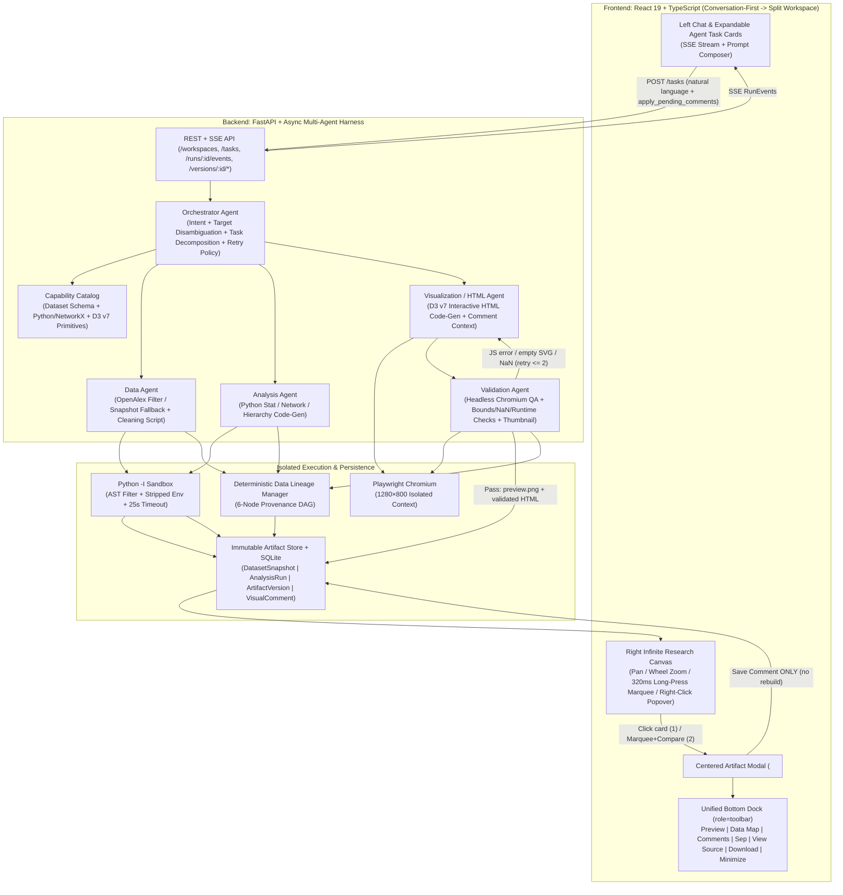
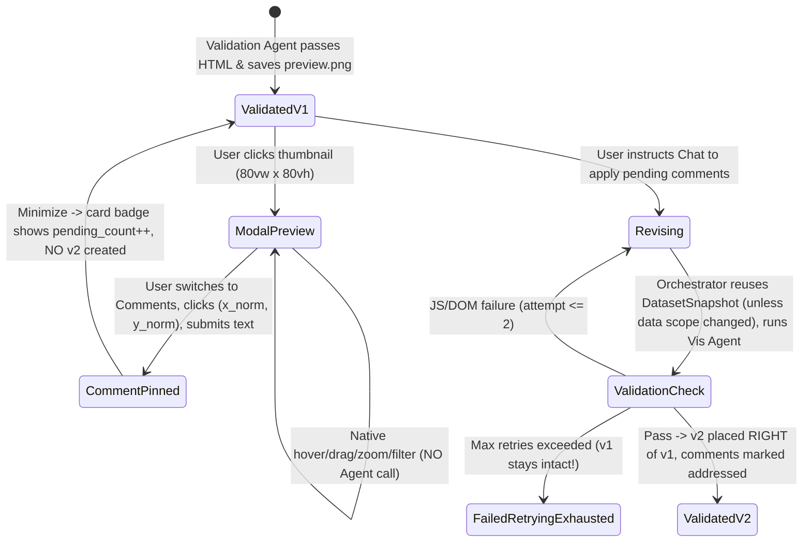

# Architecture Draft — Project 1: Research Canvas

## 1. End-to-End Multi-Agent Harness & UI Architecture



## 2. Deferred Comment-to-Revision State Machine



## 3. Immutable 6-Stage Data Map Provenance Model

```text
[1. Source] (OpenAlex API / Verified Snapshot)
     │
     ▼
[2. Collection] (Filter query, UTC timestamp, raw count, API vs cache mode)
     │
     ▼
[3. Transformation] (Data Agent Python script, filtering/cleaning rules, missingness)
     │
     ▼
[4. Dataset Snapshot] (ds_xxx — immutable records.json + schema; reused on visual-only edits)
     │
     ▼
[5. Analysis Run] (ar_xxx — Analysis Agent Python script, metrics/graph/hierarchy JSON)
     │
     ▼
[6. Visualization Artifact] (av_xxx — D3 v7 HTML + Chromium validation trace + preview.png)
```
